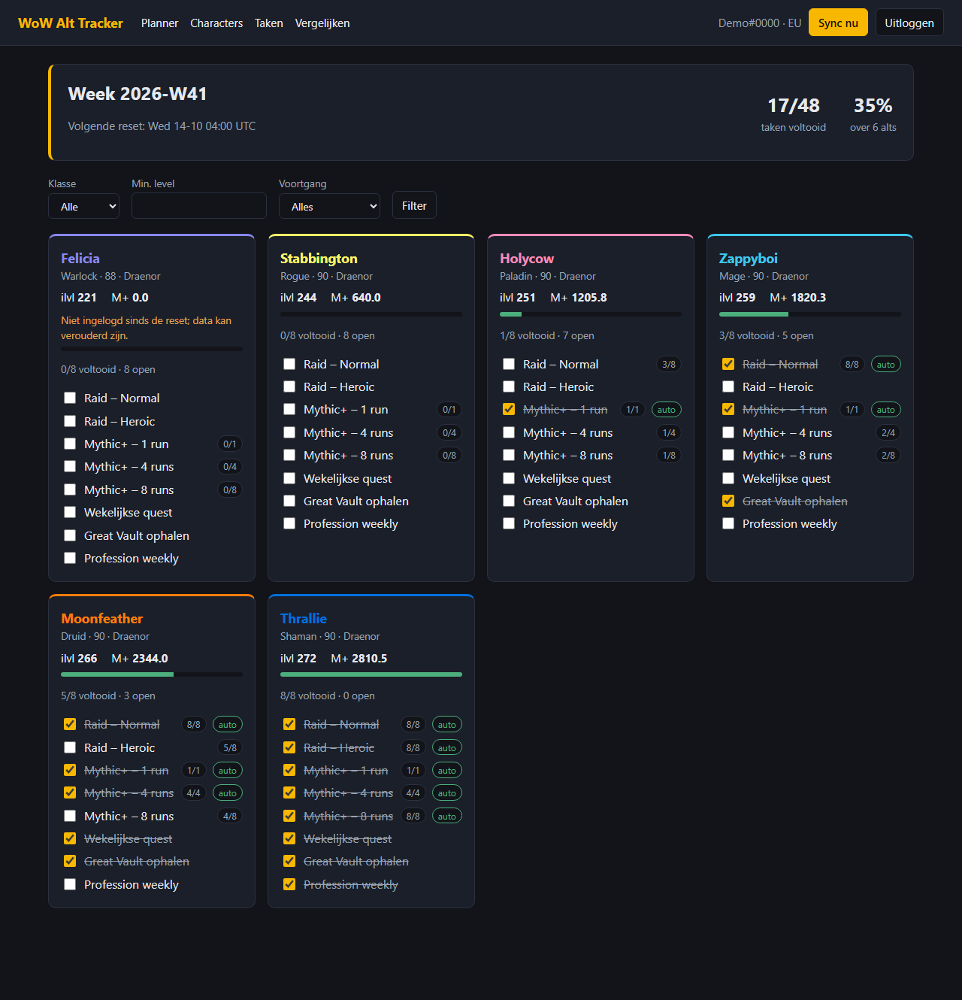
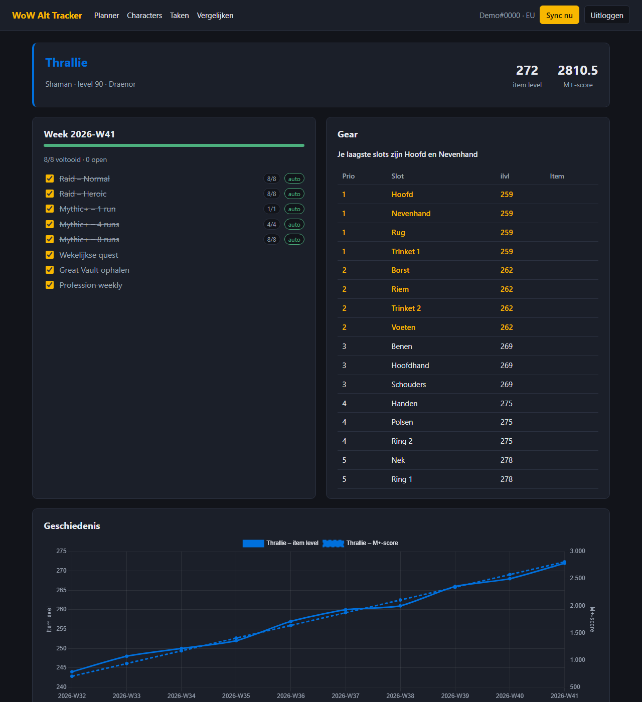
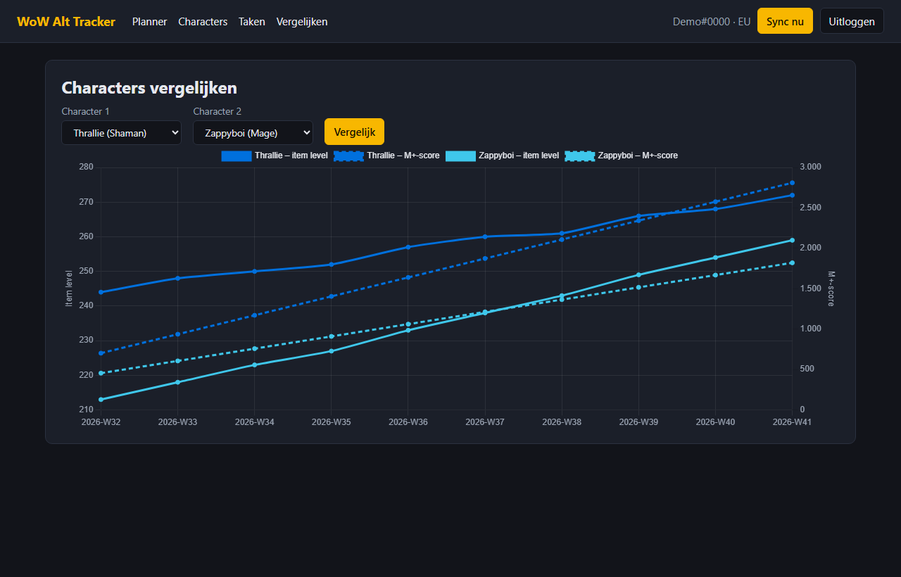

# WoW Alt Tracker

A web app for WoW players with several characters. You log in with Battle.net,
the app fetches your characters and shows the weekly to-dos, gear status and
progress over time for each of them.



| Character: checklist, gear advice and history | Comparing two characters |
| --- | --- |
|  |  |

The screenshots show the demo data from `scripts/demo.py`, not a real account.

## Getting started

1. Create a client at <https://develop.battle.net/access/clients> and set the
   redirect URL to `http://localhost:8000/auth/callback`.
2. Copy `.env.example` to `.env` and fill in `BLIZZARD_CLIENT_ID`,
   `BLIZZARD_CLIENT_SECRET` and `SECRET_KEY`.
3. Start the app:

```bash
uv sync
uv run uvicorn app.main:app --reload
```

Then open <http://localhost:8000>. Run the tests with `uv run pytest`.

Without a Battle.net client you can look at the app with made-up data:

```bash
uv run python -m scripts.demo
```

Then open <http://127.0.0.1:8000/demo-login>.

## Features

| Area | What it does |
| --- | --- |
| Login | Battle.net OAuth (Authorization Code Flow), EU/US region, tokens stored encrypted, log out and unlink |
| Characters | All characters on the account; hide or activate each one |
| Weekly checklist | Default tasks, automatic check-off through the API, manual check-off, custom tasks |
| Gear analysis | Item level per slot; the lowest slots get the highest priority |
| Planner | Dashboard sorted by most open tasks, with a weekly summary and filters |
| History | One snapshot per character per week; chart of item level and M+ score, comparison of two characters |
| Sync | "Sync now" button and scheduled sync (every 30 minutes by default), with rate limiting, retries and an ETag cache |

## Architecture

```
app/
  main.py            app factory, lifespan, scheduler
  config.py          settings from .env
  models.py          SQLModel tables
  weeks.py           week ID and reset logic
  security.py        Fernet encryption of tokens
  blizzard/
    oauth.py         authorize URL, code exchange, refresh, app token
    client.py        rate limiter, retries with backoff, ETag cache
  services/
    sync.py          character list + per character: profile, gear, M+, raids
    checklist.py     default tasks and automatic check-off
    gear.py          slot parsing and upgrade priority
    planner.py       dashboard rows, sorting, filters, summary
  routes/            auth.py (login/callback/logout) and pages.py (the rest)
  templates/, static/  Jinja2 + HTMX, Chart.js
scripts/demo.py      app with made-up data, without Battle.net
tests/               pytest + respx
```

The routes are thin: they fetch data through the services and render a
template. All logic that needs testing (weeks, check-off, gear, retries) lives
in pure functions or in classes where the clock and `sleep` can be injected.

### Two kinds of tokens

- **User token** (Authorization Code Flow): only needed for
  `/profile/user/wow`, the account's character list. Battle.net normally does
  not return a refresh token here and the token is valid for 24 hours. If a
  refresh token does come back, the app refreshes 5 minutes before expiry.
  Otherwise it asks you to log in again to refresh the character list.
- **App token** (Client Credentials): for the public character profiles. The
  app renews it by itself, so the scheduled sync keeps working after your user
  token has expired.

### Week ID and reset

The reset is fixed in UTC (`app/weeks.py`): EU Wednesday 04:00, US Tuesday
15:00. In Central Europe that is 05:00 in winter time and 06:00 in summer time.
The week ID is the ISO year and ISO week of the reset day (`2026-W41`). A
status belongs to a `week_id`; after the reset there is no status for the new
week yet, so the checklist is empty by itself. No reset job is needed.

### Automatic check-off

| Task | Checked off when |
| --- | --- |
| Raid – LFR/Normal/Heroic/Mythic | every boss of the raid has a `last_kill_timestamp` after the reset |
| Mythic+ – 1/4/8 runs | that many runs in `current_period.best_runs` have a timestamp after the reset |

A partial clear shows the progress as a badge (`3/8`). Whatever you check or
uncheck yourself is not overwritten by a sync.

## Endpoints and limitations

| Endpoint | Used for |
| --- | --- |
| `oauth.battle.net/authorize`, `/token`, `/userinfo` | login and tokens |
| `/profile/user/wow` | character list |
| `/profile/wow/character/{realm}/{name}` | level, item level, last login |
| `…/equipment` | item level per slot |
| `…/mythic-keystone-profile` | M+ score and this period's runs |
| `…/encounters/raids` | raid kills per difficulty |

- **Great Vault**: its contents are not in the API. It is a task you check off
  manually.
- **Weekly quests**: the API only knows "completed at some point", not "this
  week". Also manual.
- **M+ runs are a lower bound**: `best_runs` holds the best run per dungeon.
  Running the same dungeon twice counts as one run.
- **Raids**: the app looks at the latest expansion in the response and, per
  difficulty, at the raid with kills this week (otherwise the newest one).
- **Stale data**: characters that have not logged in since the reset get a
  warning. Runs and kills from before the reset do not count. For characters
  that have not logged in for a very long time Blizzard returns a 404; that is
  shown on the character.
- The endpoints, the reset times and the assumption that the API returns ETags
  have not been tested against the live API; the tests run on mocked
  responses. Blizzard changes the API per expansion, so check the
  [documentation](https://develop.battle.net/documentation/world-of-warcraft/profile-apis)
  if something differs.

## Not done yet

- Docker Compose, a PostgreSQL test, Discord notifications, Raider.IO
- Database migrations: tables are created at startup with `create_all`
- The interface is English only
